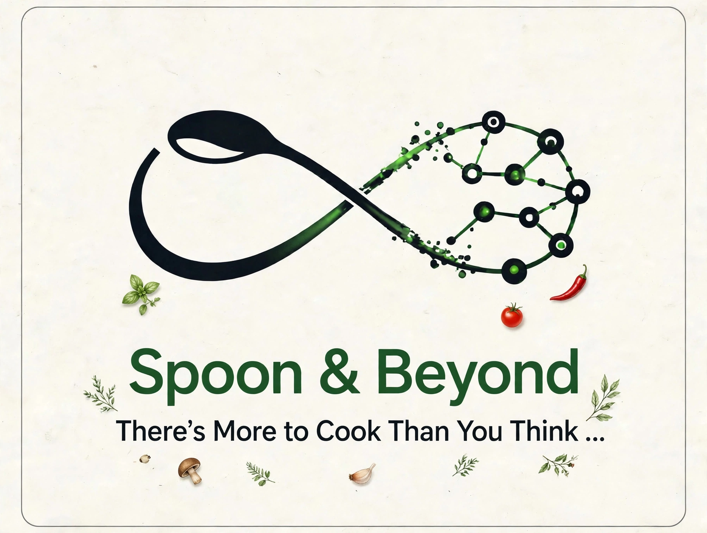
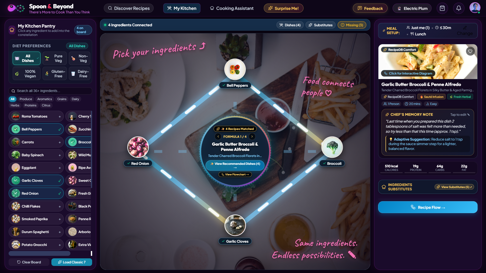
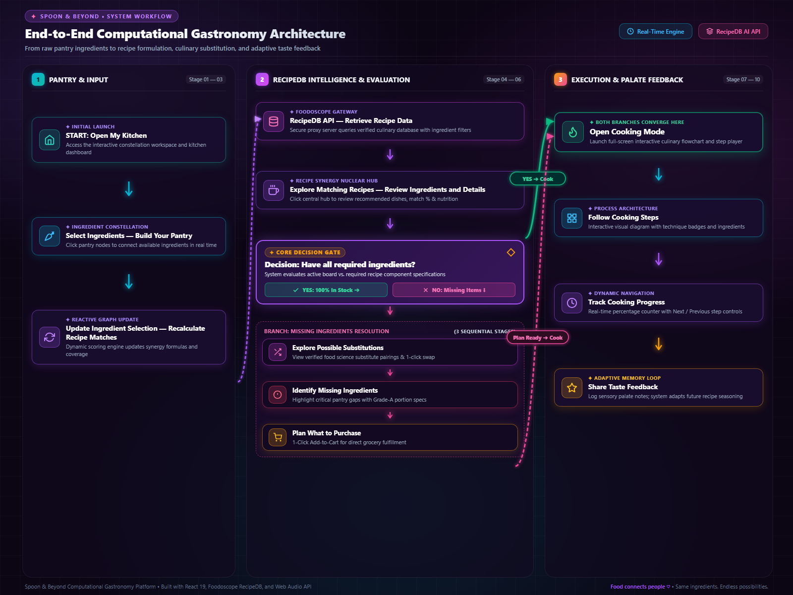
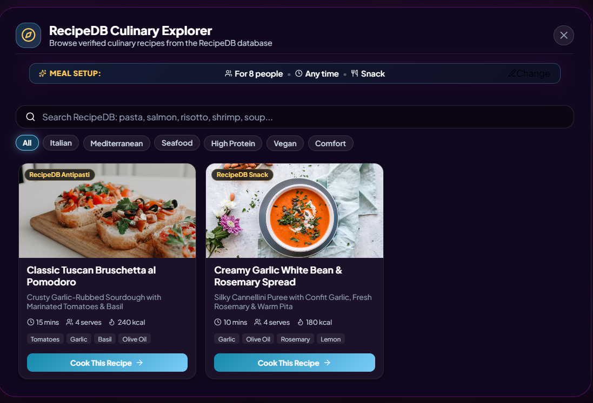
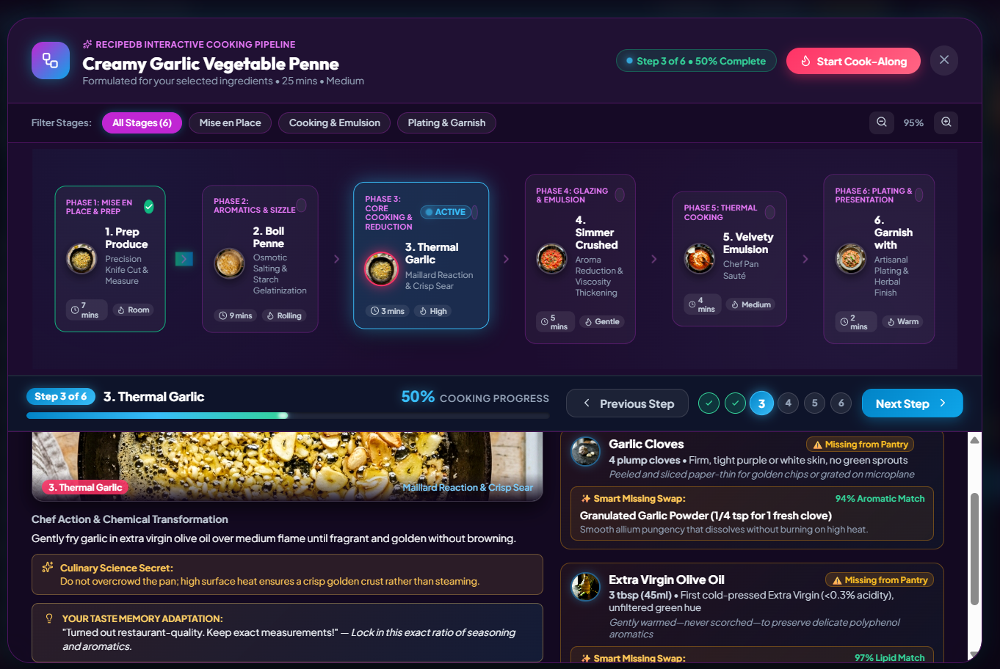
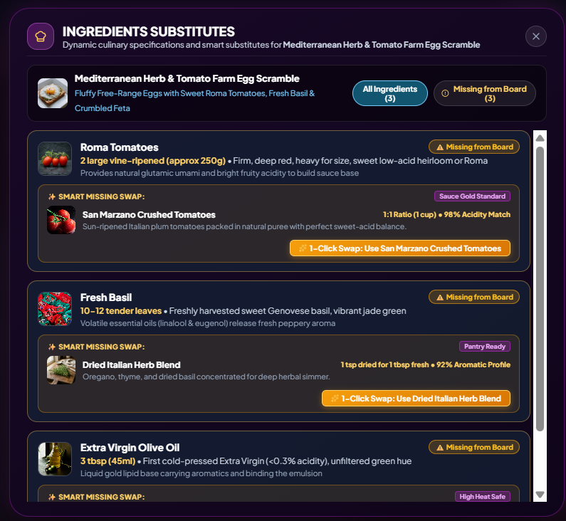
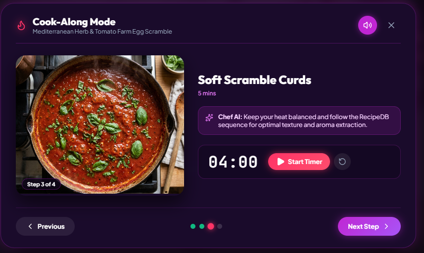
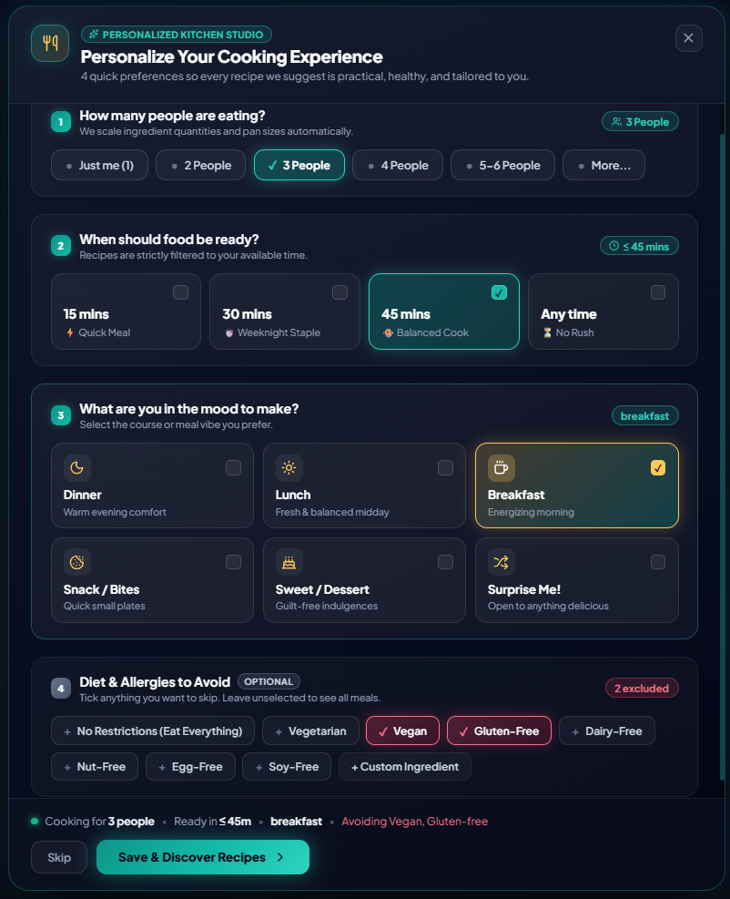
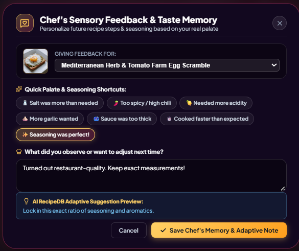
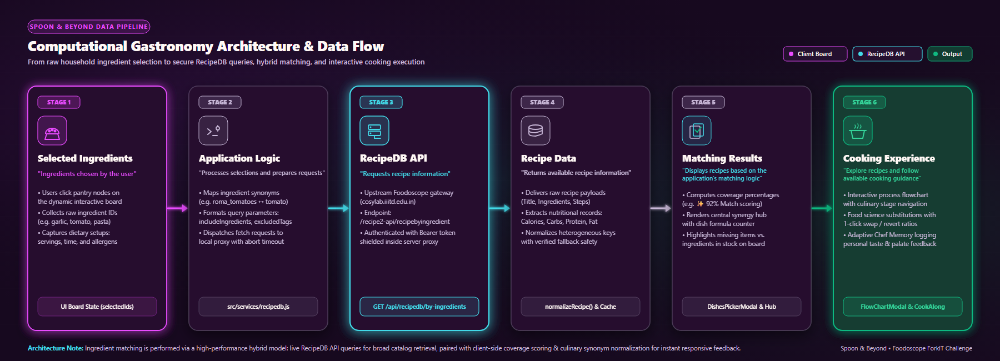

<div align="center">



# 🍳 Spoon & Beyond

### There's More to Cook Than You Think!

**Your ingredients. Your imagination. Endless possibilities.**

A computational gastronomy platform that transforms everyday ingredients into interactive recipe discoveries and guided cooking experiences.

<br/>

[](https://react.dev/)
[](https://vite.dev/)
[](https://www.foodoscope.com/)
[](https://cosylab.iiitd.edu.in/)

<br/>

**Discover · Experiment · Cook · Learn**

</div>

---

# 🍽️ What If Your Ingredients Could Inspire Your Next Meal?

We've all faced the same situation.

- 🧺 Your kitchen has ingredients, but no meal idea.
- 🥕 A recipe needs something you don't have.
- 🔍 Finding a suitable alternative feels like guesswork.
- 📖 Long instructions make cooking harder to follow.

**Spoon & Beyond changes the starting point.**

Instead of searching for a dish first, start with what you have.

Select your ingredients. Explore possible recipes. Discover alternatives. Follow a visual cooking journey.

**Turn everyday ingredients into new culinary possibilities.**

---

# ✨ Meet Spoon & Beyond

<div align="center">



*An interactive kitchen where ingredients lead the discovery.*

</div>

### 🧺 Your Kitchen, Reimagined

- **Dynamic Constellation Board** — Explore ingredients through an interactive visual interface.
- **Ingredient-Driven Discovery** — Find recipes using your selected pantry ingredients.
- **Live Recipe Exploration** — See recommendations respond to ingredient changes.
- **Smart Substitution Exploration** — Investigate alternatives when an ingredient is missing.
- **Visual Cooking Flow** — Follow recipes through structured cooking steps.
- **Personalised Cooking Experience** — Explore meal preferences and provide sensory feedback.

> **Our philosophy:** Cooking should feel like discovering something wonderful, not completing a tedious checklist.

---

## 🗺️ How It Works

Follow the journey from an empty pantry to a freshly prepared meal.

<div align="center">



**Select → Discover → Adapt → Cook → Learn**

</div>
### The Core Loop

**Select → Discover → Adapt → Cook → Learn**

Every step is designed to bring the user closer to a practical meal.

*The diagram represents the intended user journey. Actual behaviour depends on the features implemented in the application.*

---

# 🧺 01. My Kitchen — Start With What You Have

<div align="center">


</div>

Your pantry becomes the starting point for culinary exploration.

### What Makes It Different?

- 🥦 **Visual Ingredient Selection**
  - Explore available ingredients.
  - Select or remove ingredients interactively.
  - Recognise ingredients through their visual representations.

- 🕸️ **Dynamic Constellation Board**
  - Connect selected ingredients visually.
  - Make pantry exploration more engaging.
  - Discover how different ingredient combinations lead to different possibilities.

- 🔄 **Responsive Recipe Matching**
  - Update the ingredient selection.
  - Refresh the recipe suggestions.
  - Explore alternative combinations without restarting the experience.

**The idea:** Make selecting ingredients feel like creating a meal, not filling out a form.

---

# 🍝 02. Recipe Discovery — Let Ingredients Lead

<div align="center">



</div>

Explore recipes that match the ingredients you select.

### Discover

- 🍽️ Recipe names and food imagery.
- 🥕 Ingredients and quantities, when available.
- ⏱️ Preparation and cooking time, when available.
- 👥 Serving information, when available.
- 🥗 Dietary details, when supported by the source.
- 📊 Ingredient coverage and missing-item information.

### Why It Matters

Traditional recipe searches often begin with a dish name.

**Spoon & Beyond starts with the ingredients already available.**

This creates a more practical discovery experience for home cooks, students, and anyone trying to make better use of their pantry.

---

# 📖 03. Recipe Details — Know What You're Making

<div align="center">



</div>

A recipe should provide more than a title and a photograph.

### Explore the Recipe

- 📝 Recipe information.
- 🥕 Required ingredients.
- ⚖️ Available ingredient quantities.
- 👨‍🍳 Preparation instructions.
- ⏱️ Time information, when supplied.
- 🍽️ Nutritional details, when supplied.

### Our Design Principle

- Keep essential information easy to find.
- Use visual hierarchy instead of long blocks of text.
- Help users understand the dish before cooking.
- Make the transition from discovery to preparation straightforward.

---

# 🔄 04. Ingredient Substitution — Adapt, Don't Abandon

<div align="center">



</div>

Missing an ingredient shouldn't automatically mean abandoning a recipe.

### The Experience

1. Identify a missing ingredient.
2. Explore possible replacements.
3. Review the suggested alternative.
4. Check any available measurement guidance.
5. Decide whether the adaptation suits the dish.

### Why Substitutions Need Care

- Similar flavour doesn't guarantee similar texture.
- Different ingredients can change moisture and consistency.
- Substitutions may affect cooking times and methods.
- Allergens require special care.

**Our principle:** Explain alternatives honestly. Never present an unverified substitution as a guaranteed culinary equivalent.

---

# 👩‍🍳 05. Cook Mode — Turn Instructions Into Action

<div align="center">



</div>

Cooking becomes easier when instructions follow the natural sequence of preparing a dish.

### A More Visual Cooking Experience

- 🪜 Follow cooking steps in order.
- 🥕 Review relevant ingredients.
- ⏱️ Use cooking timers where implemented.
- 📍 Track progress through the recipe.
- ↔️ Move between steps.
- 💡 Explore contextual cooking guidance where available.

### The Cooking Journey

**Prepare → Heat → Cook → Adjust → Plate**

The objective is to make recipes easier to follow while helping users understand the process behind the dish.

---

# ⚙️ 06. Meal Preferences — Make It Personal

<div align="center">



</div>

Different people have different cooking needs.

### Explore Relevant Preferences

- 👥 Serving size.
- ⏰ Available preparation and cooking time.
- 🍳 Meal or dish category.
- 🥗 Dietary preferences.
- 🚫 Ingredients to avoid.

### Responsible Recommendations

- Respect declared allergies as hard exclusions.
- Keep allergies separate from dietary preferences.
- Do not claim a recipe is allergen-safe when ingredient information is incomplete.
- Do not present recipes with unknown preparation times as confirmed quick meals.
- Never silently assume a recipe's serving size is suitable for everyone.

**The goal:** Make recommendations more relevant without overwhelming users with unnecessary settings.

---

# 💬 07. Meal Feedback — Every Meal Teaches Something

<div align="center">



</div>

A recipe may be good but still need adjustment for someone's taste.

### Capture Meaningful Feedback

- ❤️ Loved it!
- 🙂 It was good.
- 🧂 Too salty.
- 🌶️ Too spicy.
- 💧 Too dry.
- 🍋 Needs more acidity.

### The Bigger Idea

Move beyond generic star ratings.

Sensory feedback can become useful information for future recommendations.

For example, a user who repeatedly prefers milder flavours may benefit from more suitable future suggestions.

*Personalisation should only be claimed when feedback is actually stored and used to influence subsequent recommendations.*

---

# 🧠 What Makes Spoon & Beyond Different?

| Conventional Recipe Search | Spoon & Beyond |
|---|---|
| Search for a dish first | Start with available ingredients |
| Browse recipe lists | Explore ingredient-driven matches |
| Treat missing ingredients as an obstacle | Investigate possible alternatives |
| Present instructions as text | Offer a structured cooking experience |
| Focus on finding a recipe | Connect discovery with preparation and feedback |

### Our Differentiating Direction

**Ingredient-first discovery + interactive visualisation + adaptive cooking workflows.**

The value is in connecting these experiences into one journey.

Rather than treating the pantry, recipe search, substitutions, and cooking instructions as separate tools, Spoon & Beyond brings them together around one question:

### 🍳 What can I make with what I have?

---

# 🔌 Powered by RecipeDB

Spoon & Beyond integrates RecipeDB from Foodoscope as its recipe-data source.

### How the Data Flows

<div align="center">



</div>

### Technology Stack

| Technology | Role |
|---|---|
| React 19 | Component-based interface |
| Vite | Development server and build tooling |
| Vanilla CSS | Styling, layout, and animations |
| JavaScript | Application interactions and logic |
| Web Audio API | Browser-based audio experiences, where implemented |
| RecipeDB | Recipe data retrieval |

### API Integration Principles

- Retrieve recipe data from RecipeDB.
- Handle loading, empty, and error states.
- Distinguish API-sourced information from application-generated suggestions.
- Avoid fabricating live API results.
- Keep credentials out of public repositories.
- Follow the official API documentation.

**Explore the platform:** [Foodoscope](https://www.foodoscope.com/)

---

# 🛠️ Run Locally

### Prerequisites

- Node.js
- npm
- The required RecipeDB access credentials, if applicable

### Installation

**1. Clone the repository**

```bash
git clone https://github.com/Aayushikumari1006/Spoon_and_Beyond.git
```

**2. Open the project**

```bash
cd Spoon_and_Beyond
```

**3. Install dependencies**

```bash
npm install
```

**4. Configure environment variables**

- Check `.env.example`.
- Create the local environment file expected by the project.
- Add the required API configuration.
- Never commit real credentials.

**5. Start the development server**

```bash
npm run dev
```

**6. Open the local address shown in your terminal.**

*Note: These commands assume your `package.json` contains the relevant scripts. Check the file if your project uses different commands.*

---

# 📁 Project Structure

```text
Spoon_and_Beyond/
│
├── public/
├── src/
├── screenshots/
│   ├── home.png
│   ├── recipe-discovery.png
│   ├── recipe-details.png
│   ├── substitution.png
│   ├── cook-mode.png
│   ├── preferences.png
│   ├── meal-feedback.png
│   └── logo.webp
│
├── .env.example
├── .gitignore
├── index.html
├── package.json
├── package-lock.json
└── vite.config.js
```

*This is an illustrative structure. Adjust it to match your actual repository.*

---

# 🔮 What's Next?

Potential future directions include:

- 🧺 Pantry quantity and expiry-aware discovery.
- 🛒 Shopping lists for missing ingredients.
- 💛 **Maa's Kitchen Wisdom** — practical, contextual cooking tips.
- 🌏 Regional ingredient names and multilingual discovery.
- 🧠 Personalised recommendations informed by stored feedback.
- 🔬 More evidence-based ingredient substitution.

These are future possibilities unless already implemented.

---

# 💛 Our Vision

Cooking is more than following instructions.

It's experimenting, learning, adapting, and creating something wonderful with what you have.

Spoon & Beyond brings ingredients, recipes, and the joy of cooking into one interactive experience.

<div align="center">

## 🧺 Start With What You Have.
## 🍳 Discover What You Can Make.

### Spoon & Beyond
### There's More to Cook Than You Think!

</div>
